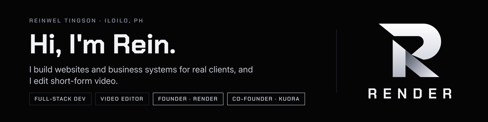

  

  
  
  

## About me

- 2nd-year BS Software Engineering student
- Founder of **RENDER**: websites, booking systems, POS and inventory tools for small businesses
- Co-founder of [**Kuora**](https://github.com/Build-with-Kuora), a dev team building websites and systems for clients
- Freelance video editor since 2022, short-form and social media content

## Featured projects

| Project | What it is | Built with |
| --- | --- | --- |
| [**iLOcate**](https://github.com/Reeiinn/Iloilo-Travel-Guide) | Navigation and tourism web app for Iloilo City: jeepney routes, landmarks, food spots and turn-by-turn directions on an interactive map | Next.js · TypeScript · Tailwind · Leaflet · OSRM |
| [**iLOcate (mobile)**](https://github.com/Reeiinn/iLOcate) | The Flutter version of iLOcate, with live location and map routing | Flutter · Dart · flutter_map · Geolocator |
| [**InsurePrep**](https://github.com/Reeiinn/Web-App-Reviewer-dq) | Exam reviewer for insurance licensing (VUL, Traditional Life, IIAP) with decks, timed exams, certificates and a staff console | Next.js · PostgreSQL · Prisma · Auth.js |
| [**PharMaMa**](https://github.com/dslvd/pharmama) | Pharmacy inventory and POS: batch and expiry tracking, receipts, sales dashboard and audit log · [live demo](https://se3pharmama.vercel.app) | Next.js · NestJS · Prisma · PostgreSQL |
| [**Clothing Store**](https://github.com/Reeiinn/Clothing_Store) | E-commerce web app with auth, product catalog and orders | Next.js · tRPC · Prisma · NextAuth |
| [**Kuora website**](https://github.com/Build-with-Kuora/Kuora-Website) | Marketing site for the Kuora dev team | Next.js · Tailwind · Framer Motion |

## Tech I use

**Languages** 

**Frontend & mobile** 

**Backend & data** 

**Tools** 

## Open to work

Freelance web projects (landing pages, booking systems, POS and inventory tools) and video editing. Reach me through my [portfolio](https://whoisrein.online).

<!-- profile README -->
